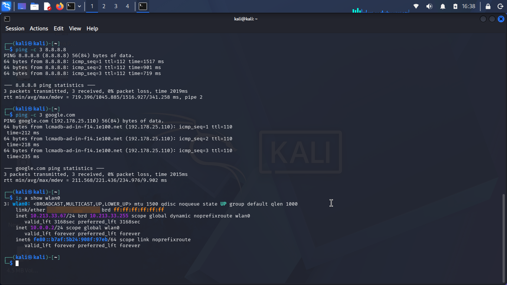
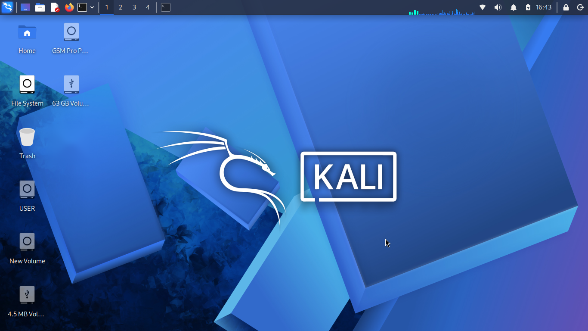

# Week 1: Cybersecurity Lab Setup (Kali Linux)

## Objective
Set up a cybersecurity testing lab with Kali Linux as the attacking machine, using the network subnet 10.0.0.0/24 with full internet access.

## What I did
- Booted Kali Linux from a live USB on my laptop
- Configured the lab IP address **10.0.0.2/24** on the `wlan0` interface
- Verified internet access by pinging 8.8.8.8 and google.com (0% packet loss)
- Captured screenshots as evidence

## Commands used
```bash
ip a                                     # find the network interface
sudo ip addr add 10.0.0.2/24 dev wlan0   # add the lab IP address
ip a show wlan0                          # verify both addresses
ping -c 3 8.8.8.8                        # test internet connectivity
ping -c 3 google.com                     # test DNS resolution
```

## Screenshots

### IP address and connectivity tests
Shows `10.0.0.2/24` configured on `wlan0`, plus successful pings to 8.8.8.8 and google.com. The Wi-Fi MAC address has been blurred for privacy.



### Kali Linux live desktop
Kali Linux running from the live USB.



## Challenge and how I handled it
Hardware virtualization (VT-x/AMD-V) is locked in my PC's BIOS, so VirtualBox could not run a 64-bit Kali VM. After confirming with my instructor, I completed this task with a Kali live USB as an approved alternative.

## Differences from the original task
| Requirement | Status |
|---|---|
| Kali Linux as attacker machine | Done (live USB) |
| IP address 10.0.0.2/24 | Done (secondary address on `wlan0`) |
| Full internet access | Done, verified with ping |
| VirtualBox and NATNetwork 10.0.0.0/24 | Not possible (virtualization locked) |
| Clipboard and drag/drop | Not applicable (VM feature) |
| Shared /downloads folder | Not done |
| VM snapshot | Not done |

## What I learned
- How virtualization depends on BIOS/UEFI settings
- How to find and configure IP addresses on Kali with the `ip` command
- How to test connectivity and DNS with `ping`
- How to work around hardware limits with an alternative setup

## Next steps
Resolve the BIOS restriction (or use another machine) to build the full VirtualBox lab with NATNetwork, then add Windows and Android target VMs in Phase 2.
